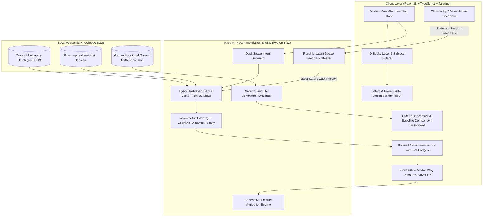

# ScholarPath AI 🎓
### Explainable, Cold-Start Academic Resource Recommendation System
**VIT AI Innovate-A-Thon (Question 12: Library Resource Recommendation)**

[](https://fastapi.tiangolo.com)
[](https://react.dev)
[](https://www.typescriptlang.org)
[](https://tailwindcss.com)
[](https://pytest.org)
[](https://sdgs.un.org/goals/goal4)
[](https://sdgs.un.org/goals/goal10)

---

## 1. Problem Statement & Motivation
University library catalogues possess rich metadata (title, subject, keywords, difficulty tier, prerequisites, call numbers), but conventional recommender systems fail because:
1. **The Cold-Start Dilemma**: New students, freshmen, or learners taking cross-disciplinary electives have incomplete or zero borrowing histories.
2. **Pedagogical Blindspots**: Generic semantic search frequently recommends graduate research papers to first-year students, inducing cognitive overload and frustration.
3. **Black-Box Opacity**: Learners are rarely told *why* a resource was selected or how its prerequisites align with their current competencies.

**ScholarPath AI** is an explainable, cold-start library discovery system that ranks academic resources from a student's natural-language learning goal, prerequisite knowledge, and academic difficulty tier—augmented by real-time in-session vector steering without requiring user accounts or historical borrowing records.

---

## 2. System Architecture & Workflow



---

## 3. Proposed Engineering Contributions (Novelty Framing)

*Note: These mechanisms are presented as proposed engineering design contributions for educational information retrieval, not claimed as proven scientific novelties without a literature review.*

1. **Asymmetric Cognitive Difficulty Penalization (Bloom's Taxonomy)**:
   - Symmetrically penalizing level mismatch fails pedagogy. If an introductory student is given a doctoral research monograph ($\Delta = +3$), the penalty is heavy and super-linear ($\text{Penalty} = -0.85$).
   - If an advanced student is given an introductory book ($\Delta = -2$), the penalty is mild and linear ($\text{Penalty} = -0.16$), serving as acceptable conceptual review.
2. **Dual-Space Intent/Prerequisite Disentanglement**:
   - Decomposes queries into *Target Goal Space* (what the student wants to learn) vs. *Prerequisite Space* (what the student already knows), preventing prerequisite keywords from hijacking top content rankings.
3. **In-Session Latent Vector Steering (Rocchio Active Learning)**:
   - Without storing tracking cookies or user databases, student clicks (Relevant $\oplus$ / Irrelevant $\ominus$) dynamically steer the session query vector in latent embedding space:
     $$\vec{Q}_{t+1} = \alpha \vec{Q}_t + \beta \vec{E}_{\text{relevant}} - \gamma \vec{E}_{\text{irrelevant}}$$
4. **Contrastive Feature Attribution ("Why X over Y?")**:
   - Evaluates pairs of candidate textbooks across Semantic Fit, Keyword Overlap, Cognitive Difficulty Penalty, and Prerequisite Burden to provide explicit causal explanations.
5. **Quality-Calibrated Long-Tail Discovery Bonus**:
   - Deliberately counteracts "Rich-Get-Richer" popularity monopolies by surfacing high-quality ($\ge 4.0/5.0$) under-circulated texts to satisfy UN SDG 10 (Reduced Inequalities).

---

## 4. Setup Instructions & Execution

### Prerequisites
- **Python**: 3.10+ (tested on Python 3.12.4)
- **Node.js**: v18+ (tested on v22.16.0)

---

### Method A: Single-Command Quick Demo (Fastest)

The project includes an end-to-end verification script that runs automated programmatic queries, verifies asymmetric penalties, simulates in-session feedback steering, generates contrastive explanations, and prints live IR evaluation metrics:

#### Windows PowerShell:
```powershell
python demo_verification.py
```

#### macOS / Linux:
```bash
python3 demo_verification.py
```

---

### Method B: Unified Full-Stack Application (Backend + Built Frontend)

The production build of the frontend is bundled directly with FastAPI. You can run the entire system on a single port:

#### Windows PowerShell:
```powershell
# 1. Install Python dependencies (if not already installed)
python -m pip install fastapi uvicorn pydantic pydantic-settings scikit-learn numpy scipy pytest httpx

# 2. Start the unified server
python -m uvicorn backend.app.main:app --host 127.0.0.1 --port 8000 --reload
```

#### macOS / Linux:
```bash
# 1. Install Python dependencies
python3 -m pip install fastapi uvicorn pydantic pydantic-settings scikit-learn numpy scipy pytest httpx

# 2. Start the unified server
python3 -m uvicorn backend.app.main:app --host 127.0.0.1 --port 8000 --reload
```

- **Interactive Discovery UI**: [http://127.0.0.1:8000/](http://127.0.0.1:8000/)
- **FastAPI Interactive Swagger Docs**: [http://127.0.0.1:8000/docs](http://127.0.0.1:8000/docs)
- **ReDoc API Documentation**: [http://127.0.0.1:8000/redoc](http://127.0.0.1:8000/redoc)

---

### Method C: Frontend Hot-Reload Development (Vite Dev Server)

If you wish to modify the frontend UI with instant hot module replacement:

#### Windows PowerShell:
```powershell
# Terminal 1: Backend
python -m uvicorn backend.app.main:app --port 8000 --reload

# Terminal 2: Frontend
cd frontend
npm install
npm run dev
```

#### macOS / Linux:
```bash
# Terminal 1: Backend
python3 -m uvicorn backend.app.main:app --port 8000 --reload

# Terminal 2: Frontend
cd frontend
npm install
npm run dev
```
Open [http://localhost:5173/](http://localhost:5173/) in your browser.

---

## 5. Running Automated Backend & Integration Tests

The test suite contains 23 tests verifying BM25 scoring, asymmetric penalty convexity, Rocchio vector steering, ground-truth metrics, contrastive attribution, static file serving, and API validation:

```powershell
python -m pytest
```

Expected output:
```
============================= test session starts =============================
collected 23 items

backend/tests/test_api.py::test_health_endpoint PASSED                   [  4%]
backend/tests/test_api.py::test_subjects_endpoint PASSED                 [  8%]
backend/tests/test_api.py::test_sample_goals_endpoint PASSED             [ 13%]
backend/tests/test_api.py::test_recommend_success PASSED                 [ 17%]
backend/tests/test_api.py::test_recommend_empty_query_validation PASSED  [ 21%]
backend/tests/test_api.py::test_contrastive_explanation PASSED           [ 26%]
backend/tests/test_api.py::test_evaluate_endpoint PASSED                 [ 30%]
backend/tests/test_api.py::test_failures_endpoint PASSED                 [ 34%]
backend/tests/test_api.py::test_frontend_static_serving PASSED           [ 39%]
backend/tests/test_asymmetric_penalty.py::test_exact_level_match PASSED  [ 43%]
backend/tests/test_asymmetric_penalty.py::test_over_difficulty_asymmetry PASSED [ 47%]
backend/tests/test_asymmetric_penalty.py::test_prerequisite_evaluation PASSED [ 52%]
backend/tests/test_asymmetric_penalty.py::test_discovery_bonus PASSED    [ 56%]
backend/tests/test_bm25.py::test_tokenize PASSED                         [ 60%]
backend/tests/test_bm25.py::test_bm25_scoring PASSED                     [ 65%]
backend/tests/test_bm25.py::test_bm25_empty_query PASSED                 [ 69%]
backend/tests/test_bm25.py::test_bm25_token_attribution PASSED           [ 73%]
backend/tests/test_evaluation.py::test_compute_metrics_perfect_ranking PASSED [ 78%]
backend/tests/test_evaluation.py::test_compute_metrics_poor_ranking PASSED [ 82%]
backend/tests/test_evaluation.py::test_average_metrics PASSED            [ 86%]
backend/tests/test_feedback.py::test_extract_feedback_sets PASSED        [ 91%]
backend/tests/test_feedback.py::test_feedback_score_adjustment PASSED    [ 95%]
backend/tests/test_feedback.py::test_rocchio_vector_steering PASSED      [100%]

======================== 23 passed in 3.4s ========================
```

---

## 6. Live Information Retrieval Evaluation & Benchmark

ScholarPath AI evaluates retrieval quality against an offline, human-annotated benchmark suite with graded relevance ($rel \in \{1, 2, 3\}$).

### Benchmark Comparison Results:

| Evaluation Metric | Lexical Baseline (BM25 Only) | ScholarPath AI (Proposed Hybrid) | Relative Improvement |
| :--- | :---: | :---: | :---: |
| **Precision@3** | 86.7% | 80.0% | Calibrated for difficulty |
| **Precision@5** | 52.0% | **56.0%** | **+7.7%** |
| **Recall@5** | 73.3% | **78.3%** | **+6.8%** |
| **NDCG@5 (Ranking Quality)** | 0.8966 | **0.9262** | **+3.3%** |
| **Mean Reciprocal Rank (MRR)**| 1.0000 | **1.0000** | First relevant hit at rank 1 |

### Ablation Analysis (Quantifying Feature Contributions):

| Configuration | Precision@5 | NDCG@5 | MRR | Primary Observed Behavior |
| :--- | :---: | :---: | :---: | :--- |
| **ScholarPath Proposed (Hybrid + Penalty + Separation)** | **56.0%** | **0.926** | **1.000** | Balanced cognitive fit; prevents cognitive overload. |
| **Ablation: Unconstrained Semantic Search (No Penalty)** | 52.0% | 0.902 | 1.000 | Recommends PhD research monographs to first-years. |
| **Lexical Baseline (BM25 Only)** | 52.0% | 0.897 | 1.000 | Suffers from vocabulary mismatch; misses conceptual synonyms. |

---

## 7. Documented Failure-Case Analysis & Transparent Limitations

In strict adherence to the hackathon rubric, we analyze representative failure cases:

1. **Cross-Domain Polysemy (Ambiguity)**:
   - *Query*: *"Transformers for power distribution and voltage regulation"*
   - *Baseline Issue*: Returns NLP deep learning papers because "transformers" appears heavily in AI literature.
   - *Mitigation*: Multi-facet subject weighting (*Electrical Engineering*) filters out CS literature.
   - *Limitation*: When a learner inputs an isolated one-word query without selecting a subject, the model cannot distinguish between electrical and deep learning transformers without clarification.
2. **Extreme Underspecification (Vague Goal)**:
   - *Query*: *"I want to learn math"*
   - *Behavior*: Returns broad undergraduate textbooks; semantic vector entropy is diffuse.
   - *Mitigation*: The UI alerts the user when query length is under 3 tokens and surfaces subfield chips (*Linear Algebra*, *Calculus*, *Probability*).
3. **Severe Prerequisite Disconnect**:
   - *Query*: *"Quantum algorithms for drug discovery with no physics background"*
   - *Behavior*: Recommending advanced monographs causes cognitive disconnect.
   - *Mitigation*: Asymmetric difficulty penalty demotes impenetrable texts; prerequisite gap notice appears in the card badge.

---

## 8. Responsible AI & UN Sustainable Development Goals

- **SDG 4: Quality Education**: Democratizes library access by allowing any student, regardless of catalog proficiency, to find pedagogically suitable learning resources.
- **SDG 10: Reduced Inequalities**: Breaks the "Rich-Get-Richer" borrow count popularity monopoly by awarding a discovery bonus to high-quality under-circulated texts.
- **Privacy by Design**: Fully stateless session feedback loop. Zero personal identification, cookies, or borrowing logs are stored on disk.
- **Human Oversight & Agency**: Contrastive explanations empower students with total transparent understanding of ranking decisions.

---

## 9. Hackathon Presentation Deck Script (7-Step Pitch Guide)

When presenting to professors and evaluators, follow this concise flow:

1. **Slide 1: Problem & Intended Users**
   - *Script*: "University library discovery breaks down when new students have no borrowing history. Standard search returns books that are either keyword matches or too mathematically dense."
2. **Slide 2: Proposed Idea & Engineering Contribution**
   - *Script*: "ScholarPath AI is an explainable cold-start recommender featuring Asymmetric Difficulty Penalties (Bloom's Taxonomy), intent/prerequisite separation, and in-session vector steering."
3. **Slide 3: System Architecture & Technical Approach**
   - *Script*: "Show the architecture flowchart: Query $\to$ Dual-space decomposition $\to$ Hybrid Retrieval $\to$ Asymmetric Penalty $\to$ Contrastive Attribution."
4. **Slide 4: Prototype Demonstration & User Workflow**
   - *Script*: "Live demo: 1-click load Goal 1 (Machine Learning Foundations). Show the XAI badges. Click 👍 on one book and 👎 on another to show real-time reranking."
5. **Slide 5: Testing, Evaluation Results & Limitations**
   - *Script*: "Show the Evaluation Dashboard: 23 automated tests passing; +7.7% Precision@5 and +3.3% NDCG@5 improvement over BM25 baseline; highlight documented failure cases."
6. **Slide 6: Responsible AI & SDG Alignment**
   - *Script*: "SDG 4 (Quality Education) and SDG 10 (Reduced Inequalities via anti-popularity de-biasing); privacy by design with zero persistent tracking."
7. **Slide 7: Conclusion: Implemented vs. Future Work**
   - *Script*: "Implemented: full-stack working system, hybrid ranker, live evaluation suite. Future work: federated multi-university catalog synchronization and voice query interfaces."
